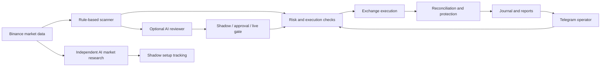

# KT Auto Trading Bot

**Python trading automation and research with Telegram operations, Binance Futures integration, and gated AI evaluation.**

Built by [gntrprygoo](https://github.com/gntrprygoo).


[](https://github.com/gntrprygoo/kt-auto-trading-bot/actions/workflows/tests.yml)


[Setup guide](docs/GETTING_STARTED.md) · [Architecture](docs/ARCHITECTURE.md) · [Case study](docs/PORTFOLIO.md) · [Operations](docs/RUNBOOK.md)

## What this project solves

Trading automation needs more than an entry signal. This project connects sizing, protective orders, account reconciliation, reporting, and strategy evaluation into an operational workflow. Telegram provides the control interface; Python handles exchange integration and persistent state.

## Engineering highlights

| Area | Implemented capability |
| --- | --- |
| Execution | Dynamic pair universe, fixed notional sizing, and dual take-profit levels |
| Protection | Stop-loss audits, post-TP1 protection, and startup reconciliation |
| Operations | Telegram commands, heartbeat, journal backups, and managed worker tooling |
| Research | Historical replay, frozen specifications, holdout reports, and acceptance gates |
| AI evaluation | Structured validation, proposal lifecycle, approval workflow, and live eligibility checks |
| Verification | Standard-library unittest suites for runtime, research, and deployment logic |

These are software capabilities, not evidence of profitable trading. Experimental strategies have separate evaluation outcomes, including rejected candidates.

## Architecture



The independent AI market scanner tracks research setups in shadow mode. Its output does not directly execute exchange orders.

## Quick start

Use Python 3.12. The core entry point and regression suite use the Python standard library.

Clone the repository and create your local configuration:

```powershell
git clone https://github.com/gntrprygoo/kt-auto-trading-bot.git
cd kt-auto-trading-bot
Copy-Item config.example.json config.json
python -m unittest discover -s tests -v
```

Edit `config.json` with your Telegram settings, exchange credentials, and local state paths. Keep AI live eligibility disabled. Start the exchange-connected simulation:

```powershell
python v3_swing_bot_fixed.py --simulate
```

Simulation can fetch market data, write local state, and send configured Telegram notifications. Use separate evaluation credentials and state paths. Windows launchers and additional commands are described in the [setup guide](docs/GETTING_STARTED.md).

## Repository map

| Path | Purpose |
| --- | --- |
| `v3_swing_bot_fixed.py` | Core execution, position management, and Telegram operations |
| `hybrid_ai_engine.py` | AI reviewer, proposals, and risk gateway |
| `ai_market_scanner.py` | Structured market-analysis client |
| `ai_range_setup.py` | Setup schema and level validation |
| `live_ai_market.py` | Live snapshots and shadow research orchestration |
| `range_setup_shadow.py` | Confirmed-candle setup lifecycle |
| `tests/` | Runtime and research regression suites |
| `tools/` | Replay, evaluation, audit, and worker utilities |
| `deploy/` | Deployment assets |
| `docs/` | Runbooks, specifications, and research results |

## Status and evidence

The core identifies as V7.4, with additional research and operational extensions. AI live eligibility is locked in the example configuration. Historical replay and shadow observation do not establish future returns. Review environment-specific deployment settings before use.

- [Engineering case study](docs/PORTFOLIO.md)
- [Hybrid AI runbook](docs/HYBRID_AI_RUNBOOK.md)
- [Live AI market shadow](docs/LIVE_AI_MARKET_SHADOW.md)
- [Research results](docs/AI_MARKET_SCANNER_PROMPT_RESEARCH_RESULT_2026-08-06.md)
- [Roadmap](docs/ROADMAP_STATUS.md) and [changelog](CHANGELOG.md)
- [Security](SECURITY.md) and [contributing](CONTRIBUTING.md)

## Risk and licensing

Futures trading can cause substantial losses. This software does not guarantee profit. Read the [risk disclosure](docs/RISK_DISCLOSURE.md).

No open-source license has been granted. Public visibility alone does not grant permission to reuse or redistribute the code.
